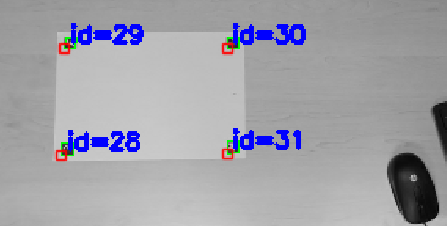

# Fiducials Detector for the ROS 2 PAR-Framework

> Readme written together with Claude Code. Comments in the Code indicate where Claude Code was used while creating this package. 



**Why a custom fiducials detector for the framework?** 
- Projector light can and will negatively affect the detection of markers. This node can handle both RGB and Near-IR images (in which the projector light becomes invisible).
- Support for depth cameras. When depth frames arrive via the provided ROS 2 interface, each detected marker gets added depth data automatically.


### Tracking Mode

Enable by setting the parameter `tracking_mode` to `True`.
Used for additional performance gains.

**When enabled**:
- **For every camera frame**: For each already known marker (from the last frames): Just check for it again in a defined area around its last known position (set via the parameter `tracking_window_size_px`) instead of in the whole frame. 
- **In a separate thread**: At a lower framerate (default 5 times per second), search the entire frame for new markers. This might take 0.2 seconds for a new or fast moved marker to be detected. But this is barely noticeable by a user.  

Tested on a laptop with a mono camera at 160fps, 1920x1200 px without dropped frames. 


### Depth Mode

When depth frames are available and the parameter `use_depth` is set to `True`, depth data is added to each detected marker: 
`corners_3d` in the published message holds its four corners in metres in the camera's optical frame (x right, y down, z forward). 
A plane is fitted to the depth inside the marker and intersected with the corners' rays, so single missing depth pixels don't matter.

- Currently, the depth image must be registered to the colour image, i.e. on the same pixel grid (`depth_registered/image_raw`).
- Frames are only processed in pairs with a depth frame. Without a depth camera, nothing is published; the node then logs a warning.
- `corners_3d` stays empty when a marker has too little valid depth.
- `corners_3d` stays empty until calibrated intrinsics arrive on `camera_info`.


### ROS 2 Topics:

**Subscribed:**

- `image_raw` (sensor_msgs/Image: colour, mono8, or 16-bit mono16/16UC1 such as infrared), or with `use_compressed`: `image_raw/compressed` (sensor_msgs/CompressedImage) for cameras like the Logitech Brio.
- With `use_depth`: `depth_registered/image_raw` (sensor_msgs/Image, 16UC1 in mm or 32FC1 in m) and `camera_info` (sensor_msgs/CameraInfo).

All names are relative, so they follow the node's namespace and remappings. Frames are subscribed with BEST_EFFORT, depth 1.

**Published:**

- `fiducials` (par_framework_interfaces/FiducialsList).
An empty list is published for frames without markers. That’s how subscribers notice that a marker disappeared.


### Available parameters

All parameters are read-only: changing one needs a restart. Per-setup values belong in `par_setup.yaml` of `par_framework_core`.

| Parameter | Default | Description |
|---|---|---|
| `marker_type` | `aruco` | `aruco` or `apriltag` |
| `dictionary` | `''` | Dictionary without the `DICT_` / `DICT_APRILTAG_` prefix, e.g. `4X4_100`, `36h11`. Empty: `4X4_100` / `36h11` |
| `corner_refinement` | `none` | `none`, `subpix`, `contour` or `apriltag`. More precise corners, slower detection |
| `adaptive_thresh_constant` | `7.0` | Constant subtracted in the adaptive thresholding. Tune it if markers are missed under projector light |
| `adaptive_thresh_win_size_min_px` | `3` | Smallest adaptive threshold window (at least 3); windows go from min to max in steps of 10 |
| `adaptive_thresh_win_size_max_px` | `23` | Largest adaptive threshold window. min = max thresholds only once: faster, if it suits the marker size |
| `bit_sample_px_per_cell` | `4` | Pixels per marker cell when reading the bits. More averages out noise on small markers |
| `bit_ignored_margin_per_cell` | `0.13` | Fraction of each cell ignored at its edges (below 0.5). Wider skips blurred edges |
| `use_depth` | `false` | See Depth Mode |
| `use_compressed` | `false` | Subscribe to `image_raw/compressed` instead of `image_raw`. Only for drivers that publish it |
| `tracking_mode` | `false` | See Tracking Mode |
| `tracking_window_size_px` | `200` | With `tracking_mode`: side length of the search window around each known marker. Must hold the marker plus its movement between two frames |
| `full_scan_rate_hz` | `5.0` | With `tracking_mode`: whole-frame searches per second. Higher finds new markers sooner, costs more CPU |
| `debug` | `false` | Show the detected markers in an OpenCV window and print the detection accuracy. Needs a display |


### How to run?

In the framework: list the cameras it should run on under `par_launch` in `par_setup.yaml`, e.g. `fiducials_detector: [overhead]`, then start `ros2 launch par_framework_core par.launch.py`. It runs in the camera's namespace and publishes on e.g. `/cameras/overhead/fiducials`.

Standalone, with your camera's topics remapped to the node's relative names:

```bash
ros2 run fiducials_detector fiducials_detector --ros-args -r image_raw:=/my_camera/image_raw -p tracking_mode:=true
```

### Package Layout

```
fiducials_detector/
├── fiducials_detector_node.py   # ROS node: parameters, topics, message conversion
├── fiducials_detector.py        # marker detection in whole frames and in windows
├── tracking/                    # only used with tracking_mode
│   ├── marker_tracker.py            # remembers markers and predicts their search windows
│   └── background_full_scanner.py   # whole-frame search in its own thread
├── depth/                       # only used with use_depth
│   ├── corners_in_camera_space.py   # corners_3d from the registered depth image
│   └── depth_arrival_monitor.py     # warns when no depth frames arrive
└── utils/
    ├── detection_preview_window.py      # debug preview window
    ├── fiducials_detector_debugger.py   # detection accuracy output
    ├── mono16_scaling.py                # scales 16-bit frames (e.g. infrared) to 8 bit
    └── serialized_image.py              # reads frames straight from serialized messages
```

---

#### Recommended Settings for fast marker tracking with IR frames:

Tested with a Flir Blackfly S (BFS-U3-23S3M-C) Mono at 160fps 1920x1200.
Camera 1.5 meter above the surface. Marker width: 20mm

```
tracking_mode: true
tracking_window_size_px: 160
full_scan_rate_hz: 5.0
adaptive_thresh_win_size_min_px: 13
adaptive_thresh_win_size_max_px: 13
bit_sample_px_per_cell: 8
bit_ignored_margin_per_cell: 0.3
```